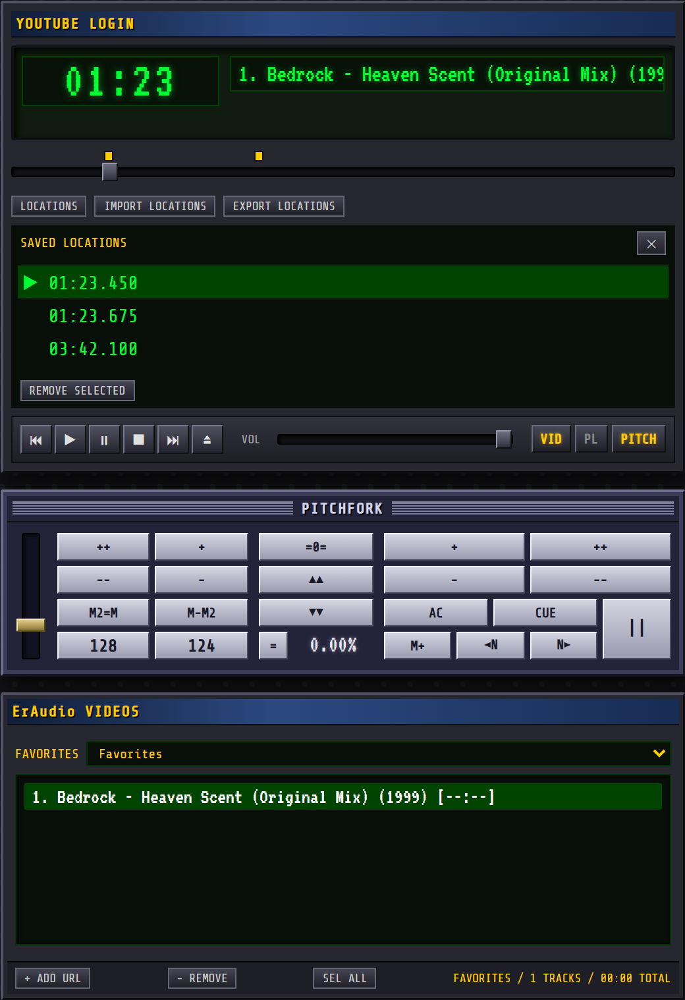

# ErAudio YouTube Web Player (with Pitchfork High-Granularity Control)

A retro YouTube audio web player interface inspired by the classic **Winamp 2.x skin**, branded as **ErAudio**, and paired with a **Pitchfork**-style playback speed control.

---

## ▶️ Quick Start (no install needed)

1. **Open the player:** <https://angleton.github.io/ErAudio/>
2. **Start listening:** Click **Open** to switch to another YouTube link or video ID; no account needed.
3. **Optional YouTube features:** use **API SETUP** to enter your own YouTube Data API key for public video chapters, or your Google OAuth client ID for **YOUTUBE LOGIN** and account playlists. See [YouTube API setup](#youtube-api-setup).
4. **Show more windows:** **VID** opens the Videos window, **PL** opens detected chapters and timestamps, and **PITCH** opens the speed control. Only the main player is visible at first.

> If Google says "this app isn't verified", click **Advanced**, then **Continue**. ErAudio only asks to *view* your YouTube account and never changes anything.

### Prefer to download it?

1. On this page, click the green **Code** button, then **Download ZIP**, and unzip it.
2. Open a terminal in the unzipped folder and run `py -m http.server 8000` (Windows; needs [Python](https://www.python.org/downloads/)).
3. Visit <http://localhost:8000> in your browser.

Pasting links works this way. For YouTube API features, configure your own credentials and authorize `http://localhost:8000` as described below.

---

## 🎯 Target UI & Design References

This project aims to preserve the compact retro-audio-player aesthetic that inspired it while establishing ErAudio as its own product identity.

### Current UI
The main player combines YouTube playback and transport controls with a position bar, saved-location markers, and import/export controls. **LOCATIONS** opens a timestamp list where a selected location can be recalled or removed; **M+** saves the current position.

The main title bar displays the current version, **v2.0**. The optional **PITCH** window contains playback-speed adjustments, two independent BPM counters, BPM matching, speed ramps, and beat-based nudging. **VID** opens the video list, while **PL** opens detected chapters and timestamps. The interface remains audio-first; YouTube playback uses an embedded player rather than a visible video screen.


<br>
*Current interface with example BPM and saved-location values; YouTube playback is simulated for this screenshot.*

---

## 🚀 Project Overview & Architecture

### Current Stage: Version 2.0
* **Standalone UI (`index.html`, `styles.css`, `app.js`):** Pixel-styled HTML5 layout for the ErAudio player, audio playlist, and Pitchfork plugin deck.
* **Audio-First Design:** Focuses on pure audio playlist playback with no embedded video player screen.
* **Granular Controls:** The horizontal speed slider spans the bottom of Pitchfork, with normal speed (0%) at its midpoint. Its left half covers `0.0625x` to `1x` and its right half covers `1x` to `4x`, so the two sides have different scales. Values are rounded to `0.0001x`, and the arrow keys adjust by that amount; YouTube playback uses the rates supported by the video.
* **Semantic Controls:** Transport buttons, toggle buttons, playlist items, checkboxes, and range sliders are real HTML controls with keyboard focus and accessible names.
* **Play control:** Press **Play** to start or resume playback. While playing, a green triangle appears beside the time and the button changes to **Pause** with a slowly pulsing yellow border; press it to pause. The border remains static when reduced motion is requested. While paused, the button looks the same as when stopped.
* **Open Input:** The Open control accepts an 11-character video ID or a YouTube watch, short, embed, Shorts, or live URL. It validates the ID format, adds the video, and starts playback through the YouTube player; a valid ID does not guarantee that the video exists or is playable. It also emits an `eraudio:control` event with the video ID.
* **Chapters and timestamps:** The PLAYLIST window detects timestamp lines in the current video's description. Entries show the time and name, wrapping long names across lines. It infers chapters from the first contiguous group that starts at 0:00, has at least three ascending entries at least 10 seconds apart, and has a final chapter at least 10 seconds long. Entries at or beyond the video's duration are excluded from the inference but remain visible, disabled, in the timestamps view. If the two lists differ, use the button in the PLAYLIST footer to switch between them; identical lists are shown once. A missing duration prevents chapter inference. These are estimates, not YouTube's actual chapter data, and automatically generated chapters not present in the description are not detected. For public videos this works without signing in when a YouTube Data API key is configured; otherwise a configured YouTube login can provide access.
* **Event Hooks:** Controls dispatch an `eraudio:control` `CustomEvent` on `document`. The interface can be opened directly as a local file; if browser storage is unavailable, other preferences fall back to in-memory values for that page session.
* **BPM buttons:** The two independent tap counters have stable IDs `bpm-left` and `bpm-right`; their control events use those IDs as their names even when the displayed BPM changes. Right-click a BPM button (or press Shift+F10 while it is focused) to enter a positive value. Press Enter or move focus away to save, or Escape to cancel. **AC** resets both counters and playback speed.
* **BPM matching:** After measuring both BPM values, **M2=M** sets the speed to right BPM divided by left BPM; **M-M2** uses left BPM divided by right BPM. Values outside the slider's range are limited to its nearest endpoint. The YouTube player may not support the requested rate.
* **Speed steps:** Each **+**, **-**, **++**, or **--** button displays its step in percentage points. Right-click it (or press Shift+F10 while focused) to edit the nonnegative value. Press Enter or move focus away to save, or Escape to cancel. Positive and negative buttons share the same step within each size and side; the left side is permanent and the right side is temporary. Initial defaults come from `ErAudio.json` when served over HTTP, and edits persist in browser storage, overriding the corresponding file values without modifying the file. Browser storage must be available to save edits.
* **Speed reset:** Hold **=** for 0% (normal speed); releasing it restores the prior speed. **=0=** permanently resets speed to 0%. Neither clears BPM values or saved locations.
* **Nudging:** **◄N** and **N►** move the playback position backward or forward by one-sixteenth of a beat in video time, using the left BPM if measured or entered, or 130 BPM otherwise. The fallback does not set the BPM counter. If a saved location is selected, nudging updates that location instead, even if playback has moved elsewhere. The updated location is saved before the preview and remains changed if the preview fails. Save or cancel an open location edit before nudging a selected location. The player pauses, plays an approximately 100 ms preview, then returns to the requested position paused. YouTube may seek to an earlier keyframe when the target is not buffered, and buffering or browser scheduling can affect preview timing, so precise beat alignment is not guaranteed.
* **Saved playback locations:** Press **M+** while a video is playing or paused to save its current position; select a marker on the position bar to seek back. **LOCATIONS** opens a chronological list for the current video with millisecond timestamps; select an entry to seek without changing play/pause state. Double-click an entry or focus it and press **F2** to edit it as `MM:SS` or `MM:SS.sss`. Save a changed value within the loaded video's duration to update the marker and seek there; an unchanged value does not save or seek again. **Escape** or **CANCEL** discards the edit. An arrow marks the last location selected from the list or bar, until the video changes or the location is cleared. Use **REMOVE SELECTED** to delete that one location; even an unavailable location can be selected in the list for removal. Up to 50 locations per video are stored in browser storage across reloads. **AC** clears the saved locations for all videos as well as resetting speed and BPM. Browser storage must be available to save or clear locations.
* **Sharing locations:** Use **EXPORT LOCATIONS** to download a JSON text file containing saved locations for the current video. The filename includes its title with special characters removed (or its video ID if the title has no usable characters). **IMPORT LOCATIONS** merges a file into local storage, skipping exact duplicates; it also accepts older exports containing multiple videos. If any video would exceed 50 locations, the entire import is rejected without changing existing locations. Importing and exporting require browser storage; exports are not automatically synchronized, and AC does not delete exported files.
* **Automatic speed ramps:** The up/down triangle buttons change speed by 1 percentage point per second by default. Moving toward normal speed stops at 0%; otherwise the ramp stops at the current YouTube video's supported limit. Click the same button to stop, the opposite button to reverse, or use another speed control to stop the ramp. YouTube audio changes only at supported discrete rates. Set `ramp.percentPerSecond` to a positive number in `ErAudio.json` to change the rate; the file is loaded over HTTP at launch.

### Planned Stack & Capabilities
* **Rust + WebAssembly (Wasm):** Rust application state management, playlist handling, keyboard shortcuts, and player logic.
* **YouTube playback:** Start with a YouTube video ID or URL entered through the ErAudio-style **Open** control. A later iteration may offer YouTube browsing/search, subject to the available YouTube APIs and their authentication, quota, and usage requirements.
* **Audio-first presentation:** The player can present YouTube playback as an audio-focused experience while retaining the underlying supported YouTube player. Extracting and redistributing raw YouTube audio is not assumed to be part of this project.
* **Playback controls:** The YouTube IFrame Player API can provide supported playback-rate controls, but it does not guarantee arbitrary floating-point rates. Pitch, tempo, spectrum analysis, and stream bitrate/sample-rate readouts are not exposed by the embed, so those controls are intentionally omitted; they would require an approved playback pipeline or a separate DSP layer rather than direct cross-origin iframe manipulation.
* **Optional browser extension interop:** A browser extension could report which tabs are marked audible through the WebExtensions `tabs` API in Chromium-based browsers and Firefox. This is useful for discovery and companion features, but it does not expose exact audio routing or the individual audio element responsible for sound.
* **Desktop window behavior:** HTML/CSS can make the player surface translucent, but a normal browser page cannot make its outer browser window transparent or define OS-level click-through regions. True transparent-window behavior requires a desktop wrapper or native host such as Electron, Tauri, WinUI, WPF, or WinForms.

### Product Direction
The goal is a compact, keyboard-friendly HTML5 ErAudio experience for YouTube listening:

1. Click **Open** and paste a YouTube URL or video ID.
2. Resolve the input into a playable YouTube item and add it to the playlist.
3. Play it through the classic ErAudio transport and playlist controls.
4. Keep the first iteration audio-focused, with video display and browsing treated as later additions.

The browser and extension APIs can help identify audible tabs, but they cannot universally identify the exact YouTube tab from Windows audio alone. If that capability becomes important, the application will need browser-specific extension integrations plus a native or desktop-wrapper component.

---

## 🖥️ Run Locally

This is a static HTML/CSS/JavaScript project. No build step, dependencies, database, or backend server are required.

### Option 1: Open the file directly

Open `index.html` in a modern browser, for example by double-clicking it in File Explorer. The URL will start with `file://`. The player interface and YouTube URL/ID parsing work locally; if the browser blocks local storage, saved preferences last only for the current page session.

### YouTube API setup

The app does not ship credentials or read `config.js`. Each user can enter credentials through **API SETUP**; opening **PL** without either credential or choosing **YOUTUBE LOGIN** without a client ID also opens the setup dialog. Both fields are optional except that login requires a client ID. Use **API SETUP** again to change a value or clear a field and save to remove it. Changing or removing the client ID ends the current app session's YouTube sign-in.

The values are stored unencrypted in the browser's local storage for this site and browser profile, not in project files or GitHub. They are accessible to scripts running on the same origin, browser extensions, and people with access to the profile. Clearing browser site data removes them. The API key is sent to Google for API requests and the client ID is sent to Google for sign-in; use website and API restrictions, and do not enter a client secret. Saving requires browser storage; if it is blocked, the app reports the failure and does not change the settings.

If you previously created a local `config.js`, it is no longer used. It remains on your computer and may still be served by a local web server until you remove it yourself.

#### Public video chapters

Public video descriptions can be retrieved without sign-in using your own YouTube Data API key:

1. In [Google Cloud Console](https://console.cloud.google.com), create or select a project and enable **YouTube Data API v3** under **APIs & Services → Library**.
2. Under **APIs & Services → Credentials**, create an API key. Restrict its API access to **YouTube Data API v3** and its website access to the sites you use, such as `https://angleton.github.io/*` and `http://localhost:8000/*`.
3. Open **API SETUP** in ErAudio, enter the key and save. Monitor your Google Cloud quota and usage.
4. Use the app over HTTP or HTTPS from an allowed website. Direct `file://` use may not supply a referrer accepted by a restricted key.

The YouTube Data API has a quota; a request can also fail because of key restrictions, network errors, or video availability. The PLAYLIST window reports failures. Reopen the video or reload the page to retry.

#### YouTube account playlists

An OAuth client ID is needed only for **YOUTUBE LOGIN** and account playlists, not for public chapters when you use an API key. Clicking **YOUTUBE LOGIN** signs in with Google, replaces the sample list with the account's **Liked videos** and own playlists, and can also retrieve video descriptions. If the browser already has a Google session that previously approved your OAuth client, sign-in is attempted automatically on page load.

1. In [Google Cloud Console](https://console.cloud.google.com), create a project (or choose an existing one).
2. Under **APIs & Services → Library**, enable **YouTube Data API v3**.
3. Under **APIs & Services → OAuth consent screen** (**Google Auth Platform** in newer consoles):
   - Choose **External** as the user type, then enter the app name and a support email.
   - Add the scope `https://www.googleapis.com/auth/youtube.readonly`.
   - While the app is in **Testing** mode, only accounts listed under **Test users** (up to 100) can sign in. Add any accounts you want to use before verification.
4. Under **Credentials → Create credentials → OAuth client ID**, choose **Web application**. Under **Authorized JavaScript origins**, add every origin the app is served from, exactly (scheme, host and port; no trailing slash or path):
   - `https://angleton.github.io` for GitHub Pages
   - `http://localhost:8000` for local runs (Option 2 below)

   Google sign-in does not work from `file://`, and no redirect URI is needed. Origin changes can take a few minutes to apply.
5. In **API SETUP**, enter the client ID (ending in `.apps.googleusercontent.com`) and save. Do not enter the client secret. Click **YOUTUBE LOGIN** to authorize your account.
6. If other accounts need access to your OAuth client, add them as test users or complete Google's publishing and verification process. The `youtube.readonly` scope is sensitive; Google's verification requirements apply.

Troubleshooting:
- `origin_mismatch` / `redirect_uri_mismatch`: the page's origin is not in step 4 exactly as written.
- `access_denied`: the account is not a test user (step 3) and the app is not yet verified.
- If settings cannot be saved, check that browser storage is enabled for the site.

Without a client ID, pasting a YouTube link still works, but account playlists are unavailable. Chapter/timestamp detection still works for public videos if an API key is configured.

### Option 2: Use a local HTTP server

From PowerShell, change to the project folder and start Python's built-in static server:

```powershell
cd C:\path\to\eraudio
py -m http.server 8000
```

Then open <http://localhost:8000> in your browser. If the `py` command is unavailable but Node.js is installed, use:

```powershell
npx serve .
```

Open the local URL printed by `serve`. Press `Ctrl+C` in the terminal to stop either server.

---

## 📁 Repository Structure

```
eraudio/
├── index.html        # HTML5 layout of ErAudio & Pitchfork UI
├── styles.css        # Retro ErAudio classic skin stylesheet
├── app.js            # Player, controls, and saved locations
├── screenshot-ui.png # Screenshot of the player UI
└── README.md         # Project documentation & reference images
```
