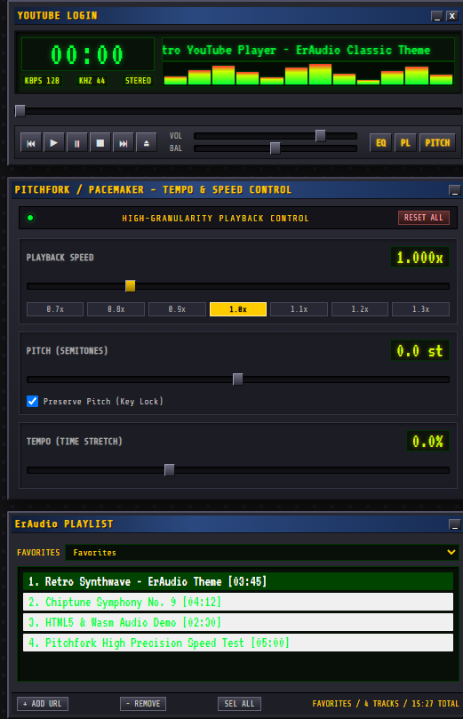

# ErAudio YouTube Web Player (with Pitchfork High-Granularity Control)

A retro YouTube audio web player interface inspired by the classic **Winamp 2.x skin**, branded as **ErAudio**, and paired with a **Pitchfork**-style playback speed control.

---

## ▶️ Quick Start (no install needed)

1. **Open the player:** <https://angleton.github.io/ErAudio/>
2. **Play something:** click **Open**, paste a YouTube link, and press **OPEN**. No account needed.
3. **Optional, load your own playlists:** click **YOUTUBE LOGIN** at the top, choose the Google account you already use for YouTube, and approve access. Your Liked videos and playlists then appear in the playlist window.
4. **Show more windows:** the **PL** button shows or hides the playlist, and **PITCH** shows or hides the speed control. Only the main player is visible at first.

> If Google says "this app isn't verified", click **Advanced**, then **Continue**. ErAudio only asks to *view* your YouTube account and never changes anything.

### Prefer to download it?

1. On this page, click the green **Code** button, then **Download ZIP**, and unzip it.
2. Open a terminal in the unzipped folder and run `py -m http.server 8000` (Windows; needs [Python](https://www.python.org/downloads/)).
3. Visit <http://localhost:8000> in your browser.

Pasting links works this way. YOUTUBE LOGIN only works if the maintainer has registered `http://localhost:8000` (see below), so the hosted link above is the easiest option.

---

## 🎯 Target UI & Design References

This project aims to preserve the compact retro-audio-player aesthetic that inspired it while establishing ErAudio as its own product identity.

### Current UI Prototype
The prototype recreates a classic retro player window (dark metallic panels, bevelled buttons, green/yellow LED matrix display) alongside a Pitchfork-style plugin window with a high-precision Speed slider and presets, plus a dedicated playlist window (pure audio playback, no video screen display in this iteration).


<br>
*(Live screenshot of the current HTML5/CSS prototype in this repo)*

---

## 🚀 Project Overview & Architecture

### Current Stage: Interactive HTML5 UI Prototype
* **Standalone UI (`index.html`, `styles.css`, `app.js`):** Pixel-styled HTML5 layout for the ErAudio player, audio playlist, and Pitchfork plugin deck.
* **Audio-First Design:** Focuses on pure audio playlist playback with no embedded video player screen.
* **Granular Controls:** Speed slider configured for high-precision steps (`0.0025x` increments, minimum `0.0625x` to match YouTube's `playbackRate` limit).
* **Semantic Controls:** Transport buttons, toggle buttons, playlist items, checkboxes, and range sliders are real HTML controls with keyboard focus and accessible names.
* **Open Input:** The Open control accepts an 11-character video ID or a YouTube watch, short, embed, Shorts, or live URL. It validates the ID format and emits an `eraudio:control` event with the input, normalized URL, video ID, query parameters, and fragment. This validates syntax only; it does not verify that a video exists or start playback.
* **Event Hooks:** Controls dispatch an `eraudio:control` `CustomEvent` on `document`. The interface can be opened directly as a local file; if browser storage is unavailable, preferences fall back to in-memory values for that page session.

### Planned Stack & Capabilities
* **Rust + WebAssembly (Wasm):** Rust application state management, playlist handling, keyboard shortcuts, and player logic.
* **YouTube playback:** Start with a YouTube video ID or URL entered through the ErAudio-style **Open** control. A later iteration may offer YouTube browsing/search, subject to the available YouTube APIs and their authentication, quota, and usage requirements.
* **Audio-first presentation:** The player can present YouTube playback as an audio-focused experience while retaining the underlying supported YouTube player. Extracting and redistributing raw YouTube audio is not assumed to be part of this project.
* **Playback controls:** The YouTube IFrame Player API can provide supported playback-rate controls, but it does not guarantee arbitrary floating-point rates. Pitch, tempo, spectrum analysis, and stream bitrate/sample-rate readouts are not exposed by the embed, so those controls are intentionally omitted; they would require an approved playback pipeline or a separate DSP layer rather than direct cross-origin iframe manipulation.
* **Optional browser extension interop:** A browser extension could report which tabs are marked audible through the WebExtensions `tabs` API in Chromium-based browsers and Firefox. This is useful for discovery and companion features, but it does not expose exact audio routing or the individual audio element responsible for sound.
* **Desktop window behavior:** HTML/CSS can make the player surface translucent, but a normal browser page cannot make its outer browser window transparent or define OS-level click-through regions. True transparent-window behavior requires a desktop wrapper or native host such as Electron, Tauri, WinUI, WPF, or WinForms.

### Product Direction
The goal is a compact, keyboard-friendly HTML5 ErAudio experience for YouTube listening:

1. Click **Open** and paste a YouTube URL or video ID.
2. Resolve the input into a playable YouTube item and add it to the playlist.
3. Play it through the classic ErAudio transport and playlist controls.
4. Keep the first iteration audio-focused, with video display and browsing treated as later additions.

The browser and extension APIs can help identify audible tabs, but they cannot universally identify the exact YouTube tab from Windows audio alone. If that capability becomes important, the application will need browser-specific extension integrations plus a native or desktop-wrapper component.

---

## 🖥️ Run Locally

This is a static HTML/CSS/JavaScript project. No build step, dependencies, database, or backend server are required.

### Option 1: Open the file directly

Open `index.html` in a modern browser, for example by double-clicking it in File Explorer. The URL will start with `file://`. The player interface and YouTube URL/ID parsing work locally; if the browser blocks local storage, saved preferences last only for the current page session.

### For maintainers: enabling YOUTUBE LOGIN for everyone

Clicking **YOUTUBE LOGIN** signs in with Google and replaces the sample playlist with the account's **Liked videos** and own playlists. If the browser already has a Google session that previously approved ErAudio, sign-in happens automatically on page load. End users never need Google Cloud access; the maintainer does this setup **once**:

1. In Google Cloud Console, enable **YouTube Data API v3** and create an OAuth 2.0 **Web application** client ID.
2. Add every origin the app is served from to **Authorized JavaScript origins**: `https://angleton.github.io` for GitHub Pages, and optionally `http://localhost:8000` for local runs. Google sign-in does not work from `file://`.
3. Put the client ID in [config.js](config.js) as `googleClientId`. The client ID is public, not a secret, so it is safe to commit.
4. Publish with **GitHub Pages**: repository **Settings → Pages → Deploy from a branch → `main` / root**.
5. Submit the app for **OAuth verification** (the `youtube.readonly` scope is sensitive; this needs a privacy policy and a short demo video). Until Google approves it, users see an "unverified app" warning and only accounts listed as **Test users** (up to 100) can sign in.

Without a client ID, pasting a YouTube link still works; only account playlists are unavailable.

### Option 2: Use a local HTTP server

From PowerShell, change to the project folder and start Python's built-in static server:

```powershell
cd C:\path\to\eraudio
py -m http.server 8000
```

Then open <http://localhost:8000> in your browser. If the `py` command is unavailable but Node.js is installed, use:

```powershell
npx serve .
```

Open the local URL printed by `serve`. Press `Ctrl+C` in the terminal to stop either server.

---

## 📁 Repository Structure

```
eraudio/
├── index.html        # HTML5 layout of ErAudio & Pitchfork UI
├── styles.css        # Retro ErAudio classic skin stylesheet
├── app.js             # Interactive control events and display-only state
├── config.js         # Google OAuth client ID for YOUTUBE LOGIN
├── screenshot-ui.png # Screenshot of the current UI prototype
└── README.md         # Project documentation & reference images
```
